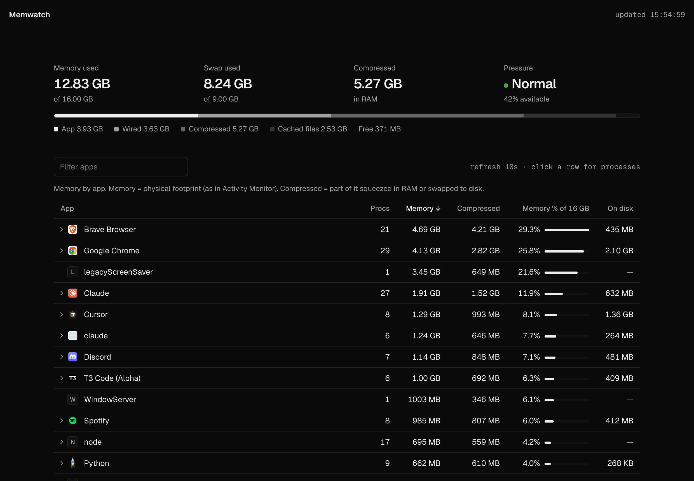
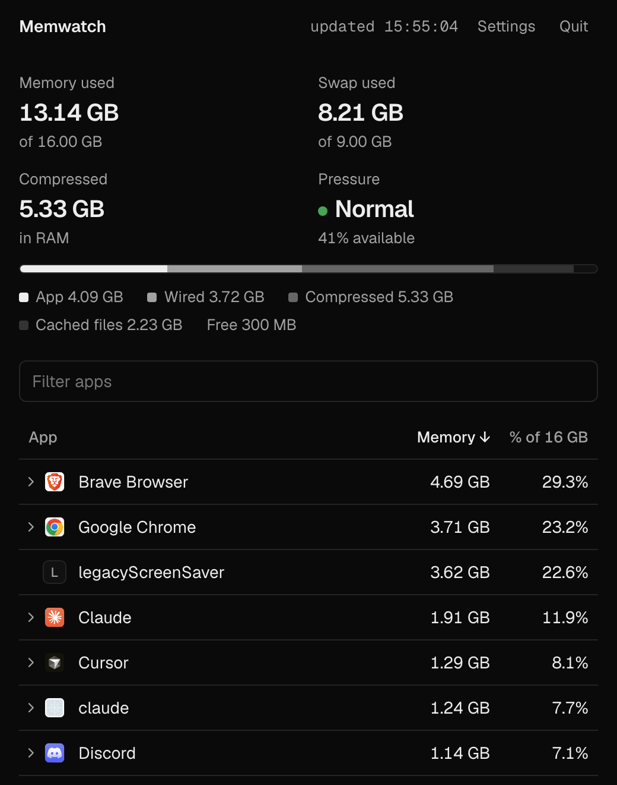
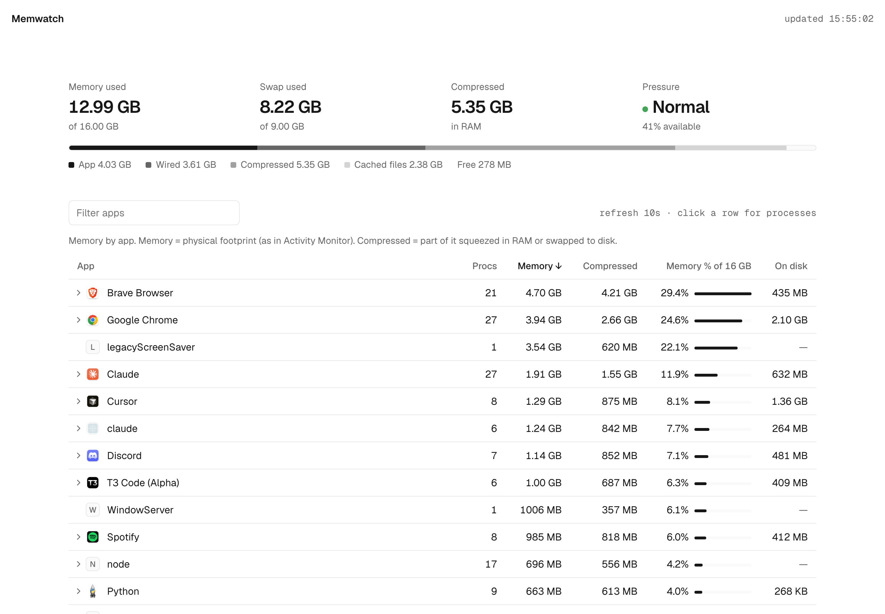

# Memwatch

A small Mac app that tells you which apps are eating your RAM.



## Why

My Mac kept going into swap and Activity Monitor wasn't much help. It lists every
helper process on its own line, so Chrome shows up as forty "Google Chrome Helper
(Renderer)" rows and you have to add them up in your head.

Memwatch groups processes by the app they belong to. So you get one row for Chrome,
one for Slack, one for whatever Electron app you forgot was open, with the real total.

## What it shows

- **Memory used, swap, compressed memory and memory pressure** at the top. The
  numbers match Activity Monitor.
- **A breakdown bar**: app memory, wired, compressed, cached files, free.
- **Every app, sorted by memory**, with its real icon. Click a row to see the
  processes inside it.
- **Compressed** per app: the part macOS has squeezed in RAM or pushed out to swap.
  macOS doesn't report swap per app, so this is the closest you can get.
- **On disk**: how much space the app itself takes on your drive. Handy when you're
  deciding what to uninstall. It's measured in the background the first time and cached,
  so big apps fill in after a few seconds.

Hover any column header for a short explanation of what it measures.

## Menu bar mode

Turn it on in Settings (<kbd>⌘</kbd> <kbd>,</kbd>) and Memwatch moves out of the Dock and into
the menu bar. It shows your memory used next to the icon, and clicking it opens a
compact version of the window.



Settings also has "Open at login" and the refresh interval (1, 3, 5 or 10 seconds).

## Install

You need macOS 13 or later, Python 3 and the Xcode command line tools
(`xcode-select --install` gets you both).

```bash
git clone https://github.com/GithubAnant/memwatch.git
cd memwatch
./build.sh
```

That builds `Memwatch.app` and copies it to `/Applications`. Open it like any other app.

Don't want the app? The whole thing also runs in a browser:

```bash
python3 memwatch.py
```

Then go to http://localhost:8799.

## How it works

There are no dependencies. It's two files:

- `memwatch.py` reads `top`, `ps`, `vm_stat` and `sysctl`, groups processes by their
  `.app` bundle, and serves the page plus a small JSON API. App icons come from
  `NSWorkspace` (the same icons Finder uses) and are cached in `~/Library/Caches/memwatch`.
- `Memwatch.swift` is a thin native window around that page. It starts the Python
  server on a free port when you open the app and stops it when you quit. If the
  server crashes, it restarts it. If the app itself is force-quit, the server notices
  and exits too, so nothing is left running in the background.

Both light and dark mode follow your system setting.

<details>
<summary>Light mode</summary>



</details>

## Good to know

- "Memory" is the physical footprint, the same number Activity Monitor shows. It
  includes the compressed part, which is why the percentages can add up to more than 100%.
- "On disk" is just the `.app` bundle. An app's documents, caches and other data live
  elsewhere in `~/Library` and aren't counted.
- The app is signed ad-hoc on your own machine by `build.sh`, so there's no
  Gatekeeper prompt. If you share the built `.app` with someone else, they'll need to
  right-click → Open the first time.
- Logs go to `~/Library/Logs/Memwatch.log` if something goes wrong.

## License

MIT
